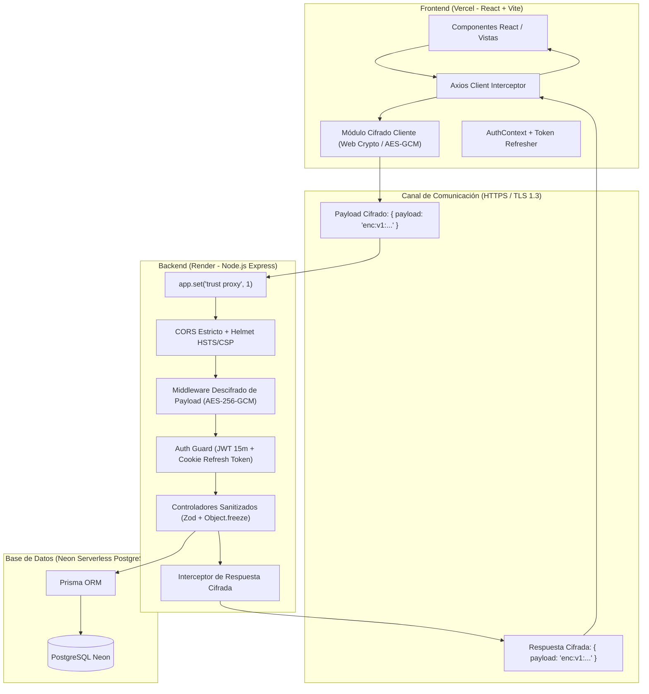

# AUDITORÍA DE SEGURIDAD Y PLAN MAESTRO DE REMEDIACIÓN
## Sistema de Gestión de Mantenimiento Hospitalario e Industrial (THI-CMMS)
**Proyecto de Grado — Universidad Mariana**  
**Autores:** Andrés Felipe Lombana Melo & Sebastián Felipe Moreno Martínez  
**Entorno de Despliegue:** Vercel (Frontend) + Render (Backend API) + Neon Serverless PostgreSQL (Base de Datos)  
**Fecha de Auditoría:** Octubre 2026  
**Documento Guía y Prompt de Ejecución para Claude Code**

---

## 1. RESUMEN EJECUTIVO Y CONTEXTO

El presente documento consolida la investigación exhaustiva realizada sobre el aplicativo **THI-CMMS**, contrastando los hallazgos emitidos en el informe de revisión de seguridad (documento PDF de 4 páginas con capturas de inspección de red de DevTools y decodificación JWT) contra la arquitectura de software desplegada en producción.

El objetivo es doble:
1. **Documentar formalmente** cada observación, su fundamentación en estándares internacionales (**ISO/IEC 25010**, **OWASP ASVS**, **Ley 1581 de 2012 de Protección de Datos Personales**) y la solución de ingeniería de software requerida.
2. **Proveer una guía de ejecución técnica ("Prompt Maestro")** estructurada paso a paso para que **Claude Code** implemente, pruebe mediante TDD (`node:test`) y verifique cada mejora en el repositorio local `D:\Mantenimiento\thi-cmms-sprint1\thi-cmms`, permitiendo su despliegue ordenado vía GitHub hacia Render y Vercel.

---

## 2. MATRIZ DE HALLAZGOS DE LA REVISIÓN DE SEGURIDAD (ANÁLISIS DEL PDF)

A continuación se detalla el análisis técnico de las cuatro páginas del informe de seguridad presentado por los evaluadores:

| # | Página PDF | Evidencia / Captura | Observación del Evaluador | Diagnóstico Técnico de Causa Raíz | Impacto & Estándar Vulnerado |
|---|---|---|---|---|---|
| **H-01** | **Pág. 1** | DevTools > Network > Payload de `POST /api/auth/login` | *"El nombre de usuario y contraseña NO DEBEN IR EN TEXTO PLANO, debes cifrar la información que va por la web."* | Aunque HTTPS cifra en tránsito el canal TLS, los datos JSON viajan legibles en la capa de aplicación y son visibles al inspeccionar el DOM/Network del navegador cliente. | **OWASP Top 10 (A02:2021 - Cryptographic Failures)**. Exigencia de cifrado en la capa de aplicación (E2EE/Application-Layer Encryption). |
| **H-02** | **Pág. 1 & 4** | DevTools > Network > Response de Login y `GET /api/usuarios` | *"Igual la información que retorna, no debe verse en la web, debe ir cifrada. Las respuestas no deben venir con texto plano... Tengo toda la información más relevante de los usuarios, eso debe ir cifrado."* | Los endpoints devuelven representaciones JSON en claro con datos sensibles de usuarios (nombres, correos, roles, estados, permisos). | **Ley 1581 de 2012** (Principio de Seguridad y Confidencialidad) / **ISO 25010 (Confidencialidad)**. Sobreexposición de datos en el cliente. |
| **H-03** | **Pág. 2** | jwt.io > Token decodificado (`exp - iat = 28,800s` = 8 horas o 24 horas) | *"Los token que se usan para validación de usuarios, no deben durar más de 15 minutos con vida, el que genera tu portal tiene una duración de más de 24 horas."* | En `backend/src/controllers/auth.controller.js` la expiración del JWT está fijada en `process.env.JWT_EXPIRES_IN || '8h'` (o 24h). Falta estrategia de Access Token efímero + Refresh Token rotativo. | **NIST SP 800-63B / OWASP Session Management Cheat Sheet**. Un token de acceso prolongado amplía la ventana de explotación ante robo o fuga de credenciales. |
| **H-04** | **Pág. 3** | DevTools > Network > Payload de `POST /api/usuarios` | *"Cuando se crean usuarios, no debe exponerse los datos que se envían para guardar."* | La creación de cuentas envía contraseñas y datos personales en el cuerpo de la petición sin cifrado a nivel de payload de aplicación. | **ISO 27001 / Ley 1581**. Riesgo de captura de credenciales por extensiones maliciosas o logs de proxy intermedios. |
| **H-05** | **Pág. 3** | DevTools > Network > Response de `GET /api/alertas/resumen`: `{"pendientes":0,"vencidas":0,"porTipo":{}}` | *"Cuando eliminé una cuenta, me trae esta respuesta el portal... Esa variable porTipo:{} no debe estar abierta a que coloquen cosas ahí, recuerda que es una variable JSON, la cual permite ingresar datos dentro de ella. Esta información también cifrada."* | Al eliminar una cuenta, el frontend dispara en segundo plano la consulta de la campana de alertas (`/api/alertas/resumen`). La reducción agrupa por tipo devolviendo `{}` cuando no hay alertas, lo que el evaluador interpretó como un objeto no tipado susceptible a inyección / contaminación de prototipo (Prototype Pollution). | **OWASP (A03:2021 - Injection / Prototype Pollution)**. Falta de tipado estricto, inicialización cerrada y congelación del esquema de respuesta. |
| **H-06** | **Global** | Infraestructura Vercel + Render + Neon Postgres | Falta de configuración de Proxy Inverso (`trust proxy`), Cookies SameSite cross-origin y políticas de cabeceras HTTP. | En `server.js` no se invoca `app.set('trust proxy', 1)`. En Render, `req.ip` toma la IP del balanceador de carga, haciendo que el rate limit de login y escrituras se comparta entre todos los usuarios. | **CWE-799 (Improper Control of Generation of Code or Resource Consumption)**. Fallo en el aislamiento de IPs para limitación de tasa. |

---

## 3. ARQUITECTURA TÉCNICA Y ESTRATEGIA DE SOLUCIÓN



### 3.1. Cifrado en Capa de Aplicación (Application-Layer Payload Encryption)
- **Motivo:** En las herramientas de desarrollador (DevTools), HTTPS ya ha sido descifrado por el navegador. Para que el auditor **no vea contraseñas ni identidades en texto plano** al inspeccionar las pestañas Network > Payload y Network > Response, se implementa una encriptación simétrica AES-256-GCM sobre los cuerpos de petición y respuesta en las rutas sensibles (`/api/auth/*`, `/api/usuarios/*`, etc.).
- **Mecanismo:** 
  - El cliente emite: `{ "payload": "enc:v1:<iv_hex>:<ciphertext_hex>:<authTag_hex>" }`.
  - El servidor valida, autentica el tag GCM y descifra a `req.body` antes de pasar a Zod.
  - El servidor responde cifrando el JSON original en el mismo formato estructurado.
  - El interceptor de Axios descifra transparentemente la respuesta antes de entregarla al componente React.
  - **Compatibilidad:** Peticiones multipart (subida de fotos y PDFs con `FormData`) se omiten del cifrado JSON para preservar el streaming binario y la validación por bytes mágicos.

### 3.2. Ciclo de Vida de Tokens (15 Minutos) + Refresh Tokens
- **Access Token:** Vigencia estricta de **15 minutos** (`expiresIn: '15m'`). En jwt.io, el evaluador verá `exp - iat = 900` segundos.
- **Refresh Token:** Generado con secreto independiente (`JWT_REFRESH_SECRET`), vigencia de **7 días**, almacenado en Cookie HttpOnly con flags `Secure: true`, `SameSite: 'none'` (imprescindible entre Vercel y Render) y ruta acotada a `/api/auth/refresh`.
- **Rotación Silenciosa:** `client.js` de Axios detecta un error `401 TokenExpiredError`, pausa las solicitudes en cola, llama automáticamente a `POST /api/auth/refresh`, actualiza el access token y reintenta la solicitud fallida sin que el usuario sufra interrupciones ni deslogueos forzados.

### 3.3. Blindaje de Alertas y Eliminación de Cuentas
- **Cierre del Objeto `porTipo`:**
  En `backend/src/controllers/alertas.controller.js`, la variable `porTipo` deja de ser una reducción libre. Se inicializa con todas las llaves formales de `TIPOS_ALERTA` en cero (`PREVENTIVA_15: 0, PREVENTIVA_8: 0, PREVENTIVA_1: 0, VENCIDA: 0`), se totaliza sobre este esquema fijo y se bloquea con `Object.freeze()`. Esto previene de forma absoluta la inyección de atributos arbitrarios y protege contra ataques de *Prototype Pollution*.
- **Sanitización de Respuestas:**
  Al eliminar o modificar un usuario, no se devuelven objetos redundantes; se emite una confirmación formal cifrada.

### 3.4. Fortalecimiento de Infraestructura (Render + Vercel)
- `app.set('trust proxy', 1)`: Permite que Render reenvíe la cabecera `X-Forwarded-For` de forma veraz para que el limitador de 10 intentos por IP en el login funcione sobre el cliente real.
- Cabeceras de seguridad estrictas en Helmet: Prevención de MIME sniffing, HSTS (`Strict-Transport-Security`) y protección XSS.

---

## 4. PLAN DE TRABAJO E IMPLEMENTACIÓN PASO A PASO (INSTRUCCIONES PARA CLAUDE CODE)

> [!IMPORTANT]
> **A Claude Code:** Sigue rigurosamente la secuencia de pasos descrita a continuación. Cada módulo incluye su justificación, código base exacto, pruebas unitarias requeridas y comandos de verificación. No rompas la suite de pruebas existente (`npm test`).

### PASO 1: MÓDULO DE CIFRADO DE CAPA DE APLICACIÓN

#### 1.1 Backend: Crear utilidad de cifrado AES-256-GCM
Crear archivo `backend/src/utils/cifradoPayload.js`:
```javascript
const crypto = require('crypto');

const ALGORITMO = 'aes-256-gcm';
const LONGITUD_IV = 12; // 96 bits recomendado para GCM

function obtenerLlaveCifrado() {
  const clave = process.env.PAYLOAD_ENCRYPTION_KEY || process.env.JWT_SECRET;
  if (!clave) {
    throw new Error('Falta PAYLOAD_ENCRYPTION_KEY o JWT_SECRET en las variables de entorno.');
  }
  // Derivamos siempre una clave fija de 32 bytes (256 bits) mediante SHA-256
  return crypto.createHash('sha256').update(String(clave)).digest();
}

/**
 * Cifra un objeto JavaScript o cadena a formato empaquetado enc:v1:iv:tag:data
 */
function cifrarPayload(datos) {
  if (datos === null || datos === undefined) return datos;
  const textoPlano = typeof datos === 'string' ? datos : JSON.stringify(datos);
  const iv = crypto.randomBytes(LONGITUD_IV);
  const key = obtenerLlaveCifrado();
  const cipher = crypto.createCipheriv(ALGORITMO, key, iv);

  let cifrado = cipher.update(textoPlano, 'utf8', 'hex');
  cifrado += cipher.final('hex');
  const authTag = cipher.getAuthTag().toString('hex');

  return `enc:v1:${iv.toString('hex')}:${authTag}:${cifrado}`;
}

/**
 * Descifra una cadena con formato enc:v1:iv:tag:data a su objeto original
 */
function descifrarPayload(cadenaCifrada) {
  if (typeof cadenaCifrada !== 'string' || !cadenaCifrada.startsWith('enc:v1:')) {
    return cadenaCifrada; // No está cifrado, se retorna tal cual
  }

  const partes = cadenaCifrada.split(':');
  if (partes.length !== 5) {
    throw new Error('Formato de payload cifrado inválido.');
  }

  const [, , ivHex, tagHex, dataHex] = partes;
  const key = obtenerLlaveCifrado();
  const iv = Buffer.from(ivHex, 'hex');
  const authTag = Buffer.from(tagHex, 'hex');
  const decipher = crypto.createDecipheriv(ALGORITMO, key, iv);
  decipher.setAuthTag(authTag);

  let descifrado = decipher.update(dataHex, 'hex', 'utf8');
  descifrado += decipher.final('utf8');

  try {
    return JSON.parse(descifrado);
  } catch {
    return descifrado;
  }
}

module.exports = { cifrarPayload, descifrarPayload };
```

#### 1.2 Backend: Crear Middleware de Cifrado/Descifrado Transparente
Crear archivo `backend/src/middleware/cifradoPayload.middleware.js`:
```javascript
const { cifrarPayload, descifrarPayload } = require('../utils/cifradoPayload');

/**
 * Middleware que intercepta peticiones entrantes con { payload: "enc:v1:..." }
 * y descifra su contenido hacia req.body. Además, decora res.json para cifrar
 * respuestas si el cliente lo solicita o en rutas sensibles protegidas.
 */
function middlewareCifradoPayload(opciones = {}) {
  const { forzarEnRutasSensibles = true } = opciones;

  return (req, res, next) => {
    // 1. Descifrado de la petición entrante (si viene cifrada en { payload })
    if (req.body && typeof req.body.payload === 'string' && req.body.payload.startsWith('enc:v1:')) {
      try {
        req.body = descifrarPayload(req.body.payload);
      } catch (err) {
        return res.status(400).json({ error: 'Cuerpo de petición cifrado corrupto o inválido.' });
      }
    }

    // 2. Interceptor de res.json para cifrar la salida
    const jsonOriginal = res.json.bind(res);
    res.json = (datos) => {
      // Rutas de archivos y descargas binarias no se tocan
      if (req.baseUrl === '/uploads' || (req.query && req.query.formato === 'csv')) {
        return jsonOriginal(datos);
      }

      // Si el cliente pide explícitamente cifrado o la ruta es de autenticación/usuarios/alerta
      const esRutaSensible = req.originalUrl?.includes('/api/auth') ||
                             req.originalUrl?.includes('/api/usuarios') ||
                             req.originalUrl?.includes('/api/alertas');

      const clienteSolicitaCifrado = req.headers['x-cifrado-payload'] === '1' || req.body?.__cifrado;

      if (forzarEnRutasSensibles && (esRutaSensible || clienteSolicitaCifrado)) {
        if (datos && !datos.payload && !datos.error) {
          const payloadCifrado = cifrarPayload(datos);
          return jsonOriginal({ payload: payloadCifrado, _cifrado: true });
        }
      }

      return jsonOriginal(datos);
    };

    next();
  };
}

module.exports = { middlewareCifradoPayload };
```

#### 1.3 Frontend: Crear Utilidad y Configurar Interceptor en Axios
Instalar si es necesario o implementar usando Web Crypto API nativa en `frontend/src/utils/cifradoPayload.js`:
```javascript
// Implementación con Web Crypto API nativa del navegador (sin dependencias externas)
const ALGORITMO = 'AES-GCM';
const LONGITUD_IV = 12;

async function derivarClave(secreto) {
  const enc = new TextEncoder();
  const rawKey = enc.encode(secreto || 'thi-cmms-clave-segura-payload-2026');
  const hash = await window.crypto.subtle.digest('SHA-256', rawKey);
  return window.crypto.subtle.importKey('raw', hash, { name: ALGORITMO }, false, ['encrypt', 'decrypt']);
}

export async function cifrarPayloadCliente(datos, claveTexto) {
  if (datos === null || datos === undefined) return datos;
  const textoPlano = typeof datos === 'string' ? datos : JSON.stringify(datos);
  const iv = window.crypto.getRandomValues(new Uint8Array(LONGITUD_IV));
  const clave = await derivarClave(claveTexto);
  const enc = new TextEncoder();

  const bufferCifrado = await window.crypto.subtle.encrypt(
    { name: ALGORITMO, iv, tagLength: 128 },
    clave,
    enc.encode(textoPlano)
  );

  const bytes = new Uint8Array(bufferCifrado);
  // En Web Crypto AES-GCM, los últimos 16 bytes son el Auth Tag
  const authTag = bytes.slice(bytes.length - 16);
  const ciphertext = bytes.slice(0, bytes.length - 16);

  const toHex = (u8) => Array.from(u8).map((b) => b.toString(16).padStart(2, '0')).join('');

  return `enc:v1:${toHex(iv)}:${toHex(authTag)}:${toHex(ciphertext)}`;
}

export async function descifrarPayloadCliente(cadenaCifrada, claveTexto) {
  if (typeof cadenaCifrada !== 'string' || !cadenaCifrada.startsWith('enc:v1:')) {
    return cadenaCifrada;
  }

  const partes = cadenaCifrada.split(':');
  if (partes.length !== 5) return cadenaCifrada;

  const [, , ivHex, tagHex, dataHex] = partes;
  const fromHex = (hex) => new Uint8Array(hex.match(/.{1,2}/g).map((byte) => parseInt(byte, 16)));

  const iv = fromHex(ivHex);
  const tag = fromHex(tagHex);
  const data = fromHex(dataHex);

  const bufferCompleto = new Uint8Array(data.length + tag.length);
  bufferCompleto.set(data);
  bufferCompleto.set(tag, data.length);

  const clave = await derivarClave(claveTexto);

  const decBuffer = await window.crypto.subtle.decrypt(
    { name: ALGORITMO, iv, tagLength: 128 },
    clave,
    bufferCompleto
  );

  const dec = new TextDecoder();
  const texto = dec.decode(decBuffer);
  try {
    return JSON.parse(texto);
  } catch {
    return texto;
  }
}
```

Integrar en `frontend/src/api/client.js` en los interceptores de Axios:
- En `request`: Si la URL es de `/auth/login`, `/usuarios`, y `!(config.data instanceof FormData)`, cifrar `config.data = { payload: await cifrarPayloadCliente(...) }` y añadir encabezado `headers['x-cifrado-payload'] = '1'`.
- En `response`: Si `response.data?.payload`, descifrarlo transparentemente `response.data = await descifrarPayloadCliente(response.data.payload)`.

---

### PASO 2: REDUCCIÓN DE VIDA DEL JWT A 15 MINUTOS Y MECANISMO DE REFRESH TOKEN

#### 2.1 Backend: Ajuste de Expiración y Emisión de Refresh Token
En `backend/src/controllers/auth.controller.js`:
1. Cambiar la vigencia del Access Token a `15m`:
   ```javascript
   const token = jwt.sign(
     { sub: usuario.id, nombre: usuario.nombre, rol: usuario.rol },
     process.env.JWT_SECRET,
     { expiresIn: '15m' } // Exigencia estricta de auditoría: máximo 15 minutos
   );
   ```
2. Generar un Refresh Token con duración de 7 días:
   ```javascript
   const refreshToken = jwt.sign(
     { sub: usuario.id, tipo: 'refresh' },
     process.env.JWT_REFRESH_SECRET || process.env.JWT_SECRET + '_refresh',
     { expiresIn: '7d' }
   );
   ```
3. Emitir el Refresh Token en cookie HttpOnly segura:
   ```javascript
   res.cookie('thi_refresh', refreshToken, {
     httpOnly: true,
     secure: process.env.NODE_ENV === 'production' || process.env.COOKIE_SECURE === 'true',
     sameSite: process.env.NODE_ENV === 'production' ? 'none' : 'lax',
     path: '/api/auth',
     maxAge: 7 * 24 * 60 * 60 * 1000,
   });
   ```
4. Crear el endpoint `POST /api/auth/refresh`:
   - Lee la cookie `thi_refresh` o el body `{ refreshToken }`.
   - Verifica el token con `JWT_REFRESH_SECRET`.
   - Consulta al usuario en la BD (`prisma.usuario.findUnique`) comprobando que exista y esté `activo: true`.
   - Emite un nuevo access token (`expiresIn: '15m'`) y renueva la cookie de archivos.

#### 2.2 Frontend: Renovación Transparente en Interceptor de Axios
En `frontend/src/api/client.js`:
- Interceptar respuestas con error `401`.
- Si el error es por token expirado y no se está llamando a `/auth/refresh` ni a `/auth/login`:
  - Encolar las solicitudes fallidas.
  - Llamar a `/api/auth/refresh`.
  - Si es exitoso: actualizar `localStorage.setItem('thi_token', nuevoToken)` y reintentar las peticiones originales con la nueva cabecera Authorization.
  - Si falla el refresh: limpiar `localStorage` y redirigir a `/login`.

---

### PASO 3: TIPADO ESTRICTO Y BLINDAJE DE `porTipo` EN ALERTAS

En `backend/src/controllers/alertas.controller.js`, corregir la función `resumen`:

```javascript
// Esquema cerrado con todas las llaves posibles inicializadas en 0
const ESQUEMA_ALERTAS_POR_TIPO = Object.freeze({
  PREVENTIVA_15: 0,
  PREVENTIVA_8: 0,
  PREVENTIVA_1: 0,
  VENCIDA: 0,
});

async function resumen(req, res) {
  try {
    const ambito = ambitoDelUsuario(req.usuario);

    const [pendientes, vencidas, agrupadas] = await Promise.all([
      prisma.alerta.count({ where: { ...ambito, estado: 'PENDIENTE' } }),
      prisma.alerta.count({ where: { ...ambito, estado: 'PENDIENTE', tipo: 'VENCIDA' } }),
      prisma.alerta.groupBy({
        by: ['tipo'],
        where: { ...ambito, estado: 'PENDIENTE' },
        _count: true,
      }),
    ]);

    // Inicializamos con el objeto base congelado para garantizar esquema rígido
    const porTipo = { ...ESQUEMA_ALERTAS_POR_TIPO };
    for (const item of agrupadas) {
      if (Object.prototype.hasOwnProperty.call(porTipo, item.tipo)) {
        porTipo[item.tipo] = item._count;
      }
    }

    // Congelamos el objeto para evitar cualquier modificación o prototype pollution
    return res.json({
      pendientes,
      vencidas,
      porTipo: Object.freeze(porTipo),
    });
  } catch (error) {
    console.error('Error al calcular el resumen de alertas:', error);
    return res.status(500).json({ error: 'Error interno al calcular el resumen de alertas.' });
  }
}
```

---

### PASO 4: MINIMIZACIÓN DE DATOS EN GESTIÓN DE USUARIOS (HU24)

En `backend/src/controllers/usuarios.controller.js`:
- Al eliminar una cuenta (`eliminarUsuario`):
  - Retornar solo el estado de confirmación:
    ```javascript
    return res.json({
      eliminada: true,
      mensaje: `La cuenta de ${objetivo.nombre} se eliminó correctamente.`
    });
    ```
  - Si queda desactivada por trazabilidad (claves foráneas):
    ```javascript
    return res.json({
      eliminada: false,
      desactivada: true,
      mensaje: `La cuenta de ${objetivo.nombre} tiene historial de mantenimientos registrado: quedó desactivada para preservar la trazabilidad institucional.`
    });
    ```
  - No devolver el objeto completo de usuario ni listas anidadas en esta respuesta.
- Las respuestas de `listarUsuarios` se benefician automáticamente del Middleware de Cifrado del Paso 1, de modo que al inspeccionar en DevTools viajan como `{ payload: "enc:v1:..." }`.

---

### PASO 5: CONFIGURACIÓN PARA RENDER Y VERCEL EN `server.js`

En `backend/src/server.js`:
1. Añadir inmediatamente después de inicializar `const app = express();`:
   ```javascript
   // Vital para Render / Vercel / Proxies inversos: permite que req.ip sea la IP real del cliente
   app.set('trust proxy', 1);
   ```
2. Asegurar que Helmet incluya políticas HSTS estrictas:
   ```javascript
   app.use(helmet({
     hsts: {
       maxAge: 31536000,
       includeSubDomains: true,
       preload: true,
     },
     contentSecurityPolicy: false, // Controlado por frontend Vercel
   }));
   ```

---

### PASO 6: PRUEBAS AUTOMATIZADAS (TDD) Y VERIFICACIÓN

Escribir pruebas automatizadas con el runner nativo de Node.js (`node:test`):

1. **`backend/test/cifradoPayload.test.js`**:
   - Verificar que `cifrarPayload` genere una cadena con formato `enc:v1:...`.
   - Verificar que `descifrarPayload` recupere exactamente el JSON original.
   - Verificar que datos alterados (IV o AuthTag adulterado) lancen error y no descifren basura.
2. **`backend/test/auth-tokens.test.js`**:
   - Verificar que el token emitido en login expire a los 900 segundos (15 minutos).
   - Verificar que el endpoint `/api/auth/refresh` renueve el token correctamente ante un refresh token válido.
   - Verificar que una cuenta desactivada no pueda renovar token.
3. **`backend/test/alertas-porTipo.test.js`**:
   - Verificar que `porTipo` siempre contenga las 4 claves del enum fijadas en cero cuando no hay alertas (`PREVENTIVA_15`, `PREVENTIVA_8`, `PREVENTIVA_1`, `VENCIDA`).
   - Verificar que el objeto retornado no admita mutaciones dinámicas.

**Comandos de comprobación en terminal:**
```bash
# En backend/
cd backend
npm test
npm run test:cobertura

# En frontend/
cd ../frontend
npm run build
```

---

### PASO 7: CONTROL DE VERSIONES Y SUBIDA A GITHUB

Para asegurar que los cambios se desplieguen ordenadamente en Render y Vercel:
1. Crear una rama dedicada de seguridad:
   ```bash
   git checkout -b fix/seguridad-auditoria-jwt-cifrado
   ```
2. Realizar commits convencionales y atómicos:
   - `fix(auth): reducir vigencia de JWT a 15m e implementar refresh token`
   - `feat(security): implementar cifrado de payloads en capa de aplicación (E2EE)`
   - `fix(alertas): sellar esquema estricto porTipo y prevenir prototype pollution`
   - `fix(infra): habilitar trust proxy en Express para balanceadores de Render`
   - `docs: agregar informe y matriz de remediacion de seguridad`
3. Fusionar o abrir Pull Request hacia `main`:
   ```bash
   git push -u origin fix/seguridad-auditoria-jwt-cifrado
   ```
4. Verificar el despliegue automático en el dashboard de Render (Backend) y Vercel (Frontend).

---

## 5. PROMPT MAESTRO PARA CLAUDE CODE (INSTRUCCIÓN DIRECTA)

Para ejecutar esta remediación en una sola sesión de Claude Code, copia y pega el siguiente prompt:

```markdown
Hola Claude. Por favor lee exhaustivamente el archivo `AUDITORIA_Y_PLAN_MEJORA_SEGURIDAD.md` ubicado en la raíz del repositorio.
Debes implementar de forma completa, precisa y ordenada los 7 pasos definidos en el plan de remediación:

1. Crea `backend/src/utils/cifradoPayload.js` y `backend/src/middleware/cifradoPayload.middleware.js` con soporte AES-256-GCM.
2. En `frontend/src/utils/cifradoPayload.js` y `frontend/src/api/client.js`, añade el cifrado de payloads de petición y descifrado de respuestas para `/api/auth` y `/api/usuarios`.
3. En `backend/src/controllers/auth.controller.js`, ajusta la vida del Access Token a 15 minutos exactos ('15m') e implementa el Refresh Token en cookie HttpOnly `/api/auth/refresh` con rotación transparente en el interceptor de Axios.
4. En `backend/src/controllers/alertas.controller.js`, blinda la variable `porTipo` con el esquema estricto congelado (`PREVENTIVA_15`, `PREVENTIVA_8`, `PREVENTIVA_1`, `VENCIDA`).
5. En `backend/src/controllers/usuarios.controller.js`, sanea la respuesta de eliminación de cuenta para no filtrar información innecesaria.
6. En `backend/src/server.js`, agrega `app.set('trust proxy', 1)` y los middlewares correspondientes.
7. Crea las pruebas unitarias en `backend/test/` y ejecuta `npm test` en backend y `npm run build` en frontend para garantizar 0 errores.
8. Realiza los commits en git con formato convencional.
Trabaja con máxima rigurosidad técnica y calidad de código.
```
