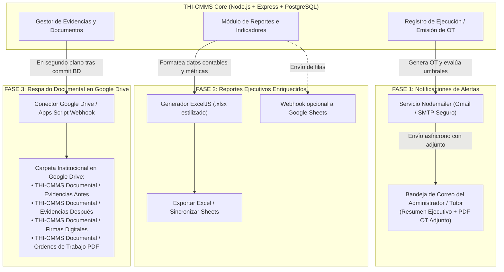

# PLAN MAESTRO DE APROPIACIÓN E INTEGRACIÓN CON EL ECOSISTEMA GOOGLE
## Sistema THI-CMMS — Proyecto de Grado Universidad Mariana
**Autores:** Andrés Felipe Lombana Melo & Sebastián Felipe Moreno Martínez  
**Objetivo:** Integrar al núcleo transaccional (React + Node.js + PostgreSQL) los 3 implementos de alto valor validados en el prototipo de Google, sin romper ninguna funcionalidad existente y con cobertura total de pruebas.  
**Ubicación del Documento:** `docs/PLAN_APROPIACION_GOOGLE_ECOSYSTEM.md`

---

## 1. Contexto Metodológico y Arquitectura de Integración

Este plan materializa la conclusión académica de la investigación de tesis:
> *"Desarrollo convencional como núcleo (React + Node.js + PostgreSQL Neon) + Ecosistema Google como complementos estratégicos auxiliares (Gmail, Sheets y Drive)."*



---

## FASE 1: NOTIFICACIONES AUTOMÁTICAS POR CORREO CON PDF ADJUNTO

### 1.1. Objetivo
Replicar exactamente la notificación del prototipo (asunto: `[ALERTA] Nueva OT generada: OT-0005 — BV-11`, resumen con costo, equipo, técnico, viñetas de alertas detectadas y el archivo `OT-XXXX.pdf` adjunto).

### 1.2. Principios de No Regresión
* El envío de correos **NUNCA** debe bloquear la respuesta HTTP ni revertir la transacción de base de datos. Se ejecuta en segundo plano (`fire-and-forget` con captura de errores en log).
* Si las credenciales de correo no están configuradas en `.env`, el servicio entra en modo pasivo (`mock` o `log`) para permitir pruebas locales y despliegues sin fallos.

### 1.3. Archivos a Crear y Modificar
1. **Dependencia:** Instalar `nodemailer` en `backend/` (`npm install nodemailer`).
2. **Configuración (`backend/src/config/correo.js`):**
   * Variables de entorno:
     * `CORREO_NOTIFICACIONES_HABILITADO=true`
     * `SMTP_HOST=smtp.gmail.com`
     * `SMTP_PORT=465` (o 587)
     * `SMTP_USER=sefemoreno123@umariana.edu.co`
     * `SMTP_PASS=xxxx xxxx xxxx xxxx` (Contraseña de aplicación de Google)
     * `CORREO_ADMINISTRADOR_DESTINO=anfelombana123@umariana.edu.co,sefemoreno123@umariana.edu.co`
3. **Servicio (`backend/src/services/correoAlertas.service.js`):**
   * Función `enviarAlertaOrdenTrabajo({ ordenTrabajo, equipo, ejecucion, alertas, pdfBuffer })`.
   * Construye el HTML y texto plano fiel a la plantilla de correo del prototipo.
4. **Integración en Controladores:**
   * En `backend/src/controllers/ejecuciones.controller.js` (al finalizar ejecución) y `backend/src/utils/ordenesAutomaticas.js`.
   * Genera el buffer del PDF con `pdfkit` (utilidad existente `pdfOrdenTrabajo.js`) y llama al servicio de correo sin bloquear la respuesta al usuario.

---

## FASE 2: REPORTES EJECUTIVOS ENRIQUECIDOS (EXCEL .XLSX + GOOGLE SHEETS)

### 2.1. Objetivo
Superar la limitación del "CSV pobre". Generar archivos de Excel (`.xlsx`) completamente diseñados con **ExcelJS** y habilitar la sincronización hacia Google Sheets.

### 2.2. Diseño de la Hoja Excel (`.xlsx`)
* **Pestaña 1: Resumen Ejecutivo e Indicadores:**
  * Tarjetas de KPI (Total intervenciones, Costo total Mano de Obra, Costo Total Insumos, Cumplimiento Preventivo).
  * Paleta visual profesional: encabezados azul marino institucional (`#1E3A8A`), texto blanco, cuadrícula clara.
* **Pestaña 2: Detalle de Intervenciones (Costos e Historial):**
  * Columnas autoajustadas con formato de fecha (`AAAA-MM-DD`), moneda colombiana (`$ #,##0`), tipos y estados con etiquetas legibles.
  * Fórmulas nativas de Excel (`SUM(F2:F100)`) para que el usuario o docente pueda auditar los cálculos.
* **Pestaña 3: Insumos y Repuestos:**
  * Desglose agrupado por equipo y descripción de repuesto.

### 2.3. Archivos a Crear y Modificar
1. **Dependencia:** Instalar `exceljs` en `backend/` (`npm install exceljs`).
2. **Generador (`backend/src/utils/reportesExcel.js`):**
   * Función `generarLibroReporte({ resumen, costos, historial, periodo })`.
   * Aplica estilos, bordes, anchos de columna y formatos numéricos.
3. **Ruta y Controlador (`backend/src/controllers/reportes.controller.js`):**
   * Permitir el parámetro `?formato=xlsx` además de `csv`.
   * Enviar la cabecera `Content-Type: application/vnd.openxmlformats-officedocument.spreadsheetml.sheet`.
4. **Frontend (`frontend/src/pages/Reportes.jsx` y `frontend/src/api/reportes.js`):**
   * Añadir botón destacado **"Descargar Reporte Ejecutivo (Excel)"** junto al exportador existente.
   * Manejar la descarga del Blob binario con nombre `THI_CMMS_Reporte_<Periodo>.xlsx`.
5. **Conector Webhook a Google Sheets (Opcional configurable):**
   * Si se define `GOOGLE_SHEETS_WEBHOOK_URL` en `.env`, el backend envía un payload JSON con las filas del reporte a un Apps Script desplegado como Web App, insertando las filas automáticamente en la hoja del docente.

---

## FASE 3: RESPALDO DOCUMENTAL EN GOOGLE DRIVE

### 3.1. Objetivo
Archivar de forma ordenada y automática las evidencias y los PDFs de las órdenes de trabajo en una nueva carpeta institucional en Google Drive: **"THI-CMMS Archivo Digital"**, manteniendo la separación de carpetas:
* `THI-CMMS Archivo Digital/`
  * `Evidencias Fotograficas (Antes)/`
  * `Evidencias Fotograficas (Despues)/`
  * `Firmas Digitales/`
  * `Ordenes de Trabajo PDF/`

### 3.2. Estrategia de Implementación Limpia (Apps Script Webhook / Drive API)
Para no complicar las credenciales OAuth en Render, se implementa mediante un **Apps Script Webhook receptor seguro**:
1. Un script ligero en Google Apps Script asociado a la cuenta de Drive que recibe peticiones `POST` autenticadas con una llave (`X-Drive-Token`).
2. El script recibe el archivo en Base64, el tipo de carpeta destino y el nombre del archivo (`OT-0005.pdf` o `evidenciaAntes-xxx.png`).
3. El script guarda el archivo en la subcarpeta correspondiente de Google Drive y retorna el enlace (`webViewLink`).
4. **Backend THI-CMMS (`backend/src/services/googleDriveRespaldo.service.js`):**
   * Cada vez que se sube una foto o se genera una OT, se envía la copia a Google Drive en segundo plano sin ralentizar la aplicación.

---

## 2. ORDEN DE EJECUCIÓN PASO A PASO PARA CLAUDE CODE

```
┌────────────────────────────────────────────────────────┐
│  PASO 1: Notificaciones de Correo con PDF (Fase 1)     │  <-- COMENZAMOS AQUÍ
│  - Instalación de nodemailer                           │
│  - Servicio de plantillas HTML y adjunto de PDF        │
│  - Disparo en segundo plano al finalizar OT            │
│  - Pruebas unitarias con transporte simulado           │
└──────────────────────────┬─────────────────────────────┘
                           │
┌──────────────────────────▼─────────────────────────────┐
│  PASO 2: Reportes Ejecutivos en Excel (Fase 2)         │
│  - Instalación de exceljs                              │
│  - Formateador de libros con estilos y fórmulas        │
│  - Soporte ?formato=xlsx en el backend                 │
│  - Botón de descarga en frontend Reportes.jsx          │
│  - Pruebas de generación y descarga                    │
└──────────────────────────┬─────────────────────────────┘
                           │
┌──────────────────────────▼─────────────────────────────┐
│  PASO 3: Respaldo Documental en Google Drive (Fase 3)  │
│  - Servicio de respaldo asíncrono                      │
│  - Estructuración de carpetas digitales                │
│  - Manejo de fallos silenciosos y trazabilidad         │
└────────────────────────────────────────────────────────┘
```
